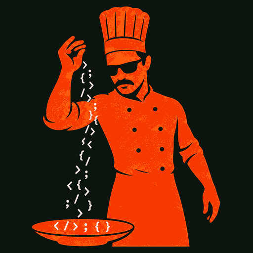
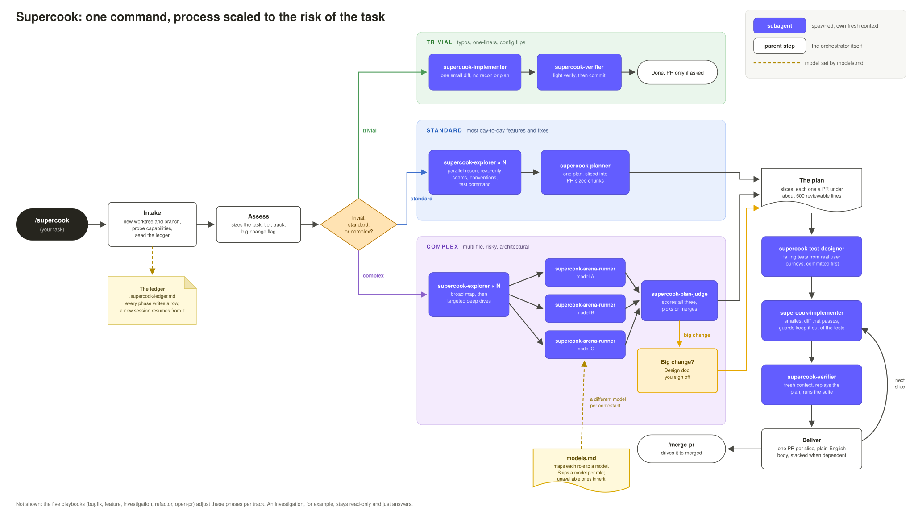

# Supercook

<p align="center">
  
</p>

A development workflow you invoke with one command that scales its own process to the risk of the task.

`/supercook fix the webhook 500s` gets a small, focused fix. `/supercook add rate limiting to the public API` gets architecture alignment, a multi-model planning arena, tests written before implementation, an independent audit, and three reviewable PRs. Same command.

## Contents

- [Why this exists](#why-this-exists)
- [When to use it, and what to expect](#when-to-use-it-and-what-to-expect)
- [The flow](#the-flow)
- [Key principles, and why they work](#key-principles-and-why-they-work)
- [Install](#install)
- [Bring your own models](#bring-your-own-models)
- [What it needs, and what happens without it](#what-it-needs-and-what-happens-without-it)
- [Usage](#usage)
- [Layout](#layout)
- [Checking that runs delegate](#checking-that-runs-delegate)
- [Development](#development)

## Why this exists

With agents writing code at unprecedented rates, skills to write code that are just focused on writing code aren't good enough. Planning, testing, and reviewing also deserve careful consideration at write time, or they become the bottleneck. `/supercook` is what I landed on after two years of daily tinkering, designed to help you cook efficiently and effectively. Here's why I think it's special:

- **One command intelligently routes based on task/complexity OR just tell it.** How many times are we struggling to find the name of the exact skill, or with the ordering of skills to accomplish a task? Just type /supercook and let the skill cook. It first classifies the complexity and routes to the appropriate playbook: a copy fix stays a two-minute fix, and a risky change gets a multi-model planning arena, test-first development, and an independent audit. If you instead want to skip the classifier and assign complexity yourself, you can.
- **Unlock easy reviews by effortlessly merging bite-size PRs.** Agents made 5k-line PRs effortless to produce, and that is where review breaks down: humans skim, review bots choke, and merges stall for days. Supercook plans work as slices under about 500 reviewable lines and opens one PR per slice, stacked when they depend on each other.
- **Agent language that actually makes sense.** Left alone, agents drift into slop in both directions: "improved error handling" that says nothing, or a wall of text that says too much. Every explanation here names the function, the file, and the ROI impact, so you can judge the work in one read and catch a wrong turn while it is one commit old instead of twelve.
- **Strict test-driven development based on user outcomes.** After a plan is created, a subagent creates tests based on what users actually do rather than a hundred random edge cases. They are committed before implementation, and the implementing agent cannot touch them. After each slice is implemented, an independent fresh-context verifier runs that suite before the slice's PR opens.
- **A supplied UI design is a contract.** Supercook resolves the exact Figma node,
  screenshot, or layout spec before planning. `plan.md` records source-traceable
  regions and order, structure tests pin them, and the real route is smoked before
  its PR opens. Reusing production components does not permit deleting or
  reordering designed regions.
- **Confidence that long-running tasks are done according to plan.** Every phase writes to a ledger on disk, so a context reset or a new session resumes from the record instead of starting over, and no step can be skipped silently. Hours-long tasks actually finish. And when they finish, an independent auditor will compare the agent's work to the initial plan and remediate any gaps.

## When to use it, and what to expect

Use it for anything development related: bugs, features, investigations, refactors, tests, performance work, and turning existing changes into a PR. Specific playbooks will be progressively inserted into context as needed per task.

One command does not mean one heavyweight process. Supercook classifies the task first, then scales ceremony to the risk:

- **Trivial.** One implementer launch, one verifier launch, done. No exploration phase, no arena, no test ceremony. A copy fix stays a copy fix. The one thing that can still fire here is architecture alignment, because a two-line change can still alter an interface other people depend on.
- **Standard.** Targeted exploration, a short plan, tests for the real user journeys, surgical implementation, an independent verification pass, and usually one reviewable PR. Most work lands here.
- **Complex.** Everything above plus a broad codebase map, architecture alignment when the approach needs sign-off, three models planning in parallel with a judge picking or merging, tests committed per slice, and multiple coherent PRs.

Tracks skip what does not apply. An investigation stays read-only and produces an answer rather than a PR, and it writes nothing to your repo at all. `open-pr` skips planning and implementation, but still verifies the diff and runs the suite before opening. A refactor starts by pinning current behavior with tests. `implement-plan` takes a plan you already wrote (often the one just created in this chat), tightens it against the code, and then runs the standard pipeline with no arena.

> Use Supercook for anything development-related. Tell it the outcome you want; it decides how much process the work deserves. Small tasks stay small. Normal changes get a focused plan, implementation, verification, and usually one reviewable PR. Large or risky changes add architecture alignment, deeper exploration, test-first development, independent review, and multiple coherent PRs. You can expect visible progress in the ledger, no silently skipped work, and a short outcome-focused handoff.

## The flow



Purple chips are subagents, each spawned with a fresh context window and a fixed contract. The three bands are the tier the coordinator picks when it classifies the task, and everything converges on the shared tail at the right, where each slice of the plan exits as its own PR. The dashed lines are `models.md` deciding which model a role runs on at launch.

## Key principles, and why they work

**Explanations name the file, the change, and the real consequence.** Written like a sharp junior engineer who just read the code, not like a changelog. "We changed `handleWebhook` in `src/api/webhook.ts` because it still referenced a `retryCount` variable the queue rewrite deleted, so any real webhook would have thrown and taken the server down." Not "improved error handling". This is the principle that makes the rest checkable, so it sits at the top of the skill. An opinionated style choice, not a research finding.

**Subagents with clean context and terse return contracts.** The agent that runs `/supercook` coordinates: it classifies the task itself, and the named `supercook-*` workers do recon, planning, tests, implementation, and verification, at every tier, whenever the session can spawn one. Each playbook step that needs a worker names it, so the launch sits in the checklist the run follows rather than in a rule it has to remember. Each role gets an objective, inputs, an effort budget, boundaries, and a fixed output shape, so results stay small and the orchestrator's context stays usable. ([Anthropic on multi-agent systems](https://www.anthropic.com/engineering/multi-agent-research-system))

**The ledger as external memory.** Every phase and every skip is written to a file, so context resets and new sessions resume from the record rather than from a guess. ([Anthropic on context engineering](https://www.anthropic.com/engineering/effective-context-engineering-for-ai-agents), the structured note-taking pattern)

**Ceremony scales with complexity.** Single agent first, the arena only when the task pays for it. ([Building Effective Agents](https://www.anthropic.com/engineering/building-effective-agents), [OpenAI's practical guide to building agents](https://cdn.openai.com/business-guides-and-resources/a-practical-guide-to-building-agents.pdf))

**The arena plus a judge** is parallelization combined with the evaluator-optimizer pattern: three independent plans, then one agent picking or merging with stated provenance. ([Building Effective Agents](https://www.anthropic.com/engineering/building-effective-agents))

**Effort budgets and boundaries in every delegation.** Agents over-invest and under-invest without an explicit scale, which Anthropic reports as their most common multi-agent failure mode. ([Anthropic on multi-agent systems](https://www.anthropic.com/engineering/multi-agent-research-system))

**Progressive disclosure.** `SKILL.md` stays around 120 lines, playbooks are a checklist plus a few rules, and each step names the one reference it needs, so a guide only enters context when a step calls for it. ([Anthropic on Agent Skills](https://www.anthropic.com/engineering/equipping-agents-for-the-real-world-with-agent-skills))

**Action-risk tiers.** Read-only actions run, reversible writes run and get logged, irreversible ones ask, with one exception: a merge you explicitly asked for is its own consent and runs to merged without re-asking. ([OpenAI's practical guide to building agents](https://cdn.openai.com/business-guides-and-resources/a-practical-guide-to-building-agents.pdf))

**Test-driven, with the suite protected.** Failing tests are committed first, the implementing agent is forbidden from touching them, and the orchestrator restores any test file that gets modified anyway. That last part matters: an instruction alone does not stop an agent bending a test until it passes. ([Cursor's agent best practices](https://cursor.com/blog/agent-best-practices))

**Boundaries are parent-checked after returns.** Every rule that matters has a check the coordinator runs once the agent returns, as a command in `scripts/guard.py`: test files untouched, changes inside the slice, red tests confirmed, the line budget. Prompts express intent; those checks are the control. The plugin's hooks only nudge: a `postToolUse` launch logger, and a stop hook that echoes the ledger's next open step and names checked worker steps with no logged launch, plus skips or inline marks the ledger rules do not allow. It stays silent at a `[!]` pause, asks for a launch only when that step's worker has not run yet, acts only while `.supercook/active-run` names a live run, and never denies anything.

**Designed UI is checked twice.** Semantic regions, counts, and DOM order are
test-first. Geometry, responsive behavior, visible data, and interactions are
checked on the rendered route. The structural verifier never claims it visually
inspected a page it did not open.

**Opinionated style choices**, with no research behind them and no pretense otherwise: surgical diffs, PRs under about 500 reviewable lines, keep going wherever host permissions allow, and no em dashes anywhere.

## Install

This repo is its own Cursor marketplace, so the shortest path is to add it once and install from Customize:

```bash
cursor-agent plugin marketplace add https://github.com/hsaab/supercook
```

Open Customize in the sidebar, find **Supercook** under `supercook-marketplace`, and install it. When new commits land, pull them in with:

```bash
cursor-agent plugin marketplace update supercook-marketplace
```

If you would rather have a checkout you can edit, clone it straight into the local plugins folder, and update it with `git pull`:

```bash
git clone https://github.com/hsaab/supercook.git ~/.cursor/plugins/local/supercook
```

Two rules from [Cursor's plugin docs](https://cursor.com/docs/plugins#test-plugins-locally) decide whether that checkout is the one that loads. Cursor skips a link in `~/.cursor/plugins/local` that points at a checkout elsewhere on disk, so clone into the folder rather than linking to it. And a marketplace install with the same name takes precedence over the local copy, so keep one install or the other: an old marketplace install hides a newer local checkout.

Either way, reload the window, then confirm you see two skills (`supercook`, `setup-supercook`) and seven agents (`supercook-explorer`, `-planner`, `-arena-runner`, `-plan-judge`, `-test-designer`, `-implementer`, `-verifier`). A `supercook-assessor` or `supercook-plan-optimizer` in that list means an older install is loaded too, or a stale copy sits in `~/.cursor/agents/`.

Every run opens with the copy it loaded, for example `supercook 0.7.0 from ~/.cursor/plugins/local/supercook`. If that names a `plugins/cache/` path when you meant the local checkout, or an older version, remove the other install before going further.

A skill folder mirrored on its own (for example a personal `~/.cursor/skills/supercook` synced to Cloud Agents) carries no agent files, because they live at the plugin root in `agents/`. On such a host, also copy the agents into your user subagent directory so Cursor lists them as named subagents (`/supercook-explorer`, `/supercook-implementer`, and so on):

```bash
mkdir -p ~/.cursor/agents && cp ~/.cursor/plugins/local/supercook/agents/supercook-*.md ~/.cursor/agents/
rm -f ~/.cursor/agents/supercook-assessor.md ~/.cursor/agents/supercook-plan-optimizer.md   # an older install's agents
```

Your application repositories do not need their own copy in `.cursor/agents/`. Without the agents in the catalog, Supercook launches each role as `generalPurpose` pointed at its agent file.

### Keep it on for the whole chat

A plain `/supercook` attaches the skill to one message, and it fades as a long run moves on. To keep it in context on every turn, pick `/supercook` from the `/` menu with Option+Enter (Mac) or Alt+Enter (Windows) instead of Enter. That makes it a [Custom Mode](https://cursor.com/docs/skills#using-a-skill-as-a-custom-mode), available in the Agents Window and the CLI.

### On Cloud Agents

A cloud VM cannot see your local home directory, so three things decide whether a run gets typed `supercook-*` agents:

- **Plugins installed on your account load on the VM at the commit the marketplace last resolved**, which can be far behind this repo. Refresh the marketplace after a release, then start a new agent: [a running Cloud Agent keeps the plugin versions it started with](https://cursor.com/docs/plugins#keep-plugins-up-to-date).
- **That marketplace install wins over a local copy of the same name.** An environment install script that clones a pinned checkout into `~/.cursor/plugins/local/supercook` gets the skill files onto the VM, but it does not replace an older marketplace install's agents.
- **Plugin hooks do not load on Cloud Agents.** [Cursor's hook docs](https://cursor.com/docs/agent/hooks#cloud-agent-support) list project, team, and enterprise sources for the cloud. Without them the run still follows the playbook, and `scripts/guard.py ledger` still cross-checks it before delivery. For the launch log and the stop nudge on a VM, clone the plugin to `~/.cursor/plugins/local/supercook` in the install step and commit this as the repo's `.cursor/hooks.json`. Neither hook can block a call, and each prints `{}` when the clone is missing:

```json
{
  "version": 1,
  "hooks": {
    "postToolUse": [
      {
        "command": "python3 -B \"$HOME/.cursor/plugins/local/supercook/scripts/launch_log.py\" 2>/dev/null || echo {}",
        "matcher": "Task|Subagent|CreateAgent|CallDynamicTool",
        "timeout": 5
      }
    ],
    "stop": [
      {
        "command": "python3 -B \"$HOME/.cursor/plugins/local/supercook/scripts/ledger_followup.py\" 2>/dev/null || echo {}",
        "loop_limit": 2,
        "timeout": 5
      }
    ]
  }
}
```

- **The subagent list is fixed when the session starts.** An agent file copied into `~/.cursor/agents/` during a run does not join that run's list. Do the `cp` and `rm` above in the environment's install step.

To see what a run got, read its first line and the subagent types it lists. Seven `supercook-*` names, with no `supercook-assessor` or `supercook-plan-optimizer`, means the current agents are typed. Either of those two means the VM loaded an older install: refresh the marketplace, and run the `rm` above if the install step copies agents into `~/.cursor/agents/`. None means every role launches as `generalPurpose` pointed at its agent file. All of these run the same steps: the coordinator launches a worker for every worker step, at every tier, and runs a role itself only when the session has no spawn tool at all.

**No spawn tool?** Some Cloud Agents never get `Task`. The run then switches to solo mode: the same steps, each handed off through a file in `.supercook/<run>/`, with red tests committed on their own, the same `guard.py` checks before every commit, and a verify step that re-reads the diff from disk and runs the suite. The arena does not run. The PR says it was built in solo mode with no independent review. Details are in [skills/supercook/references/workers.md](skills/supercook/references/workers.md#solo-mode).

One thing to know before the first run: without worktree support it works on your current branch, and in that case it needs a clean tree. It will say so rather than stashing anything.

The marketplace above is one you add to your own account. It is not a listing in the official Cursor Marketplace, which is a separate submission step.

## Bring your own models

Nine roster keys, one line each: `standard` (planner, test-designer, verifier), the three arena contestants, the plan judge, implementer, explorer, `reviewer` (the external reviewers on the review track), and `review-implementer`. Each ships with a default slug in [skills/supercook/models.md](skills/supercook/models.md).

Three files merge per role, highest tier wins for that role only: `<workspace-root>/.supercook/models.md` (optional, commit it so cloud agents and other clones pick it up), then `~/.supercook/models.md`, then the shipped file. Edit an override, not the plugin copy, because a marketplace update replaces the plugin directory.

```bash
mkdir -p ~/.supercook
curl -fsSL https://raw.githubusercontent.com/hsaab/supercook/main/skills/supercook/models.md -o ~/.supercook/models.md
```

Keep the roles you want to change and delete the rest; write `inherit` to use the session model. The coordinator resolves the roster once and writes a `models:` line in the ledger. **Models are a preference, not a gate**: a launch that rejects a slug is relaunched on the session model, and "use opus for the implementer" applies from the next launch on. Run `/setup-supercook` once to check every roster slug against what your session can launch and to write a one-sentence delegation rule to the repo's `.cursor/rules/`. If you override the arena, keep the three contestants on different model families; their disagreement is the point of the cook-off.

## What it needs, and what happens without it

Happiest with git, GitHub plus an authenticated `gh`, worktree support, and a runnable test suite. It degrades rather than fails without them:

| Missing | What happens |
|---|---|
| GitHub or `gh` | Stops at a pushed branch, with the PR body written to the run folder |
| A test runner | Tests become an executable verification recipe the verifier runs |
| Worktrees | Works on the current branch, after saying so, and requires a clean tree |
| git | Works in place, delivers a summary and the diff |
| The plugin's agents | Each role launches as `generalPurpose` pointed at its agent file; with no spawn tool, roles run inline from the agent file bodies |
| A renderer for a changed UI route | Writes a fully specified manual smoke and asks once for confirmation. A PR can disclose missing visual evidence, but never calls the route visually verified |

**One limit worth knowing.** Run artifacts live in `.supercook/` in your repo, untracked, excluded via git's local exclude file rather than your `.gitignore`. They survive new sessions in the same checkout. They do not travel to another machine or a cloud agent unless you deliberately commit the ledger.

## Usage

```
/supercook <what you want>
/supercook use this plan                  # implement the plan just created in this chat
/supercook implement .cursor/plans/rate-limiting.md
/supercook plan only <what you want>      # stop after the plan
/supercook no PR <what you want>          # implement and verify, do not open a PR
/supercook no commits <what you want>     # leave the changes uncommitted
/supercook keep ledger <what you want>    # commit the ledger so another machine can resume
/supercook <what you want> and merge it   # carry on through the merge
/supercook merge PR 412                   # drive an existing PR to merged, nothing to build
/supercook review                         # run Bugbot, security, and Thermos reviews on each slice PR and fix the real findings
/supercook review and merge               # full external review on each PR bottom-up, then merge one PR at a time (not bulk merge before reviews)
```

Merging never happens unless you ask for it. Without that ask a run ends at an open PR, and a PR that looks mergeable is not an ask. Once you have asked, the ask is the consent: supercook states and logs the merge sequence and continues until the work is merged, stopping only for things it may never bypass (branch protection, missing required approvals, failing required checks).

After plan mode, `/supercook use this plan` in the same chat is enough. No path needed. Name a file only when you want a different plan than the one in this conversation.

`review and merge` stays on the **review** track (full reviewer fan-out per PR), not the merge-only track. Playbooks route from the coordinator's classification except `merge`, `implement-plan`, and `review`, which you select in your ask and which route before classification:


| Track | What it does differently |
|---|---|
| bugfix | Reproduces first, proves the root cause, lands a failing repro test before the fix |
| feature | Names the data shape before the logic, tests real journeys, full pipeline |
| investigation | Read-only, cited answer, no plan or tests or PR, and nothing written to your repo |
| refactor | Pins current behavior with characterization tests, reroutes if behavior changes |
| open-pr | No planning or source implementation; existing designed UI gets retrospective structure tests, verification, and smoke |
| merge | Drives an existing PR to merged whatever state it is in: conflicts, review comments, broken CI, stalled checks, stacks |
| implement-plan | Tightens a plan you already wrote, then the standard pipeline with no arena |
| review | Runs Bugbot, security, and Thermos reviewers on each slice PR (reusing Bugbot and security review results already on the PR's current head), implements the triaged findings, and merges only when you asked for that too |

## Layout

```
.cursor-plugin/               plugin manifest, plus the marketplace manifest for this repo
agents/                       seven discoverable subagents, all supercook- prefixed
hooks/hooks.json              the plugin's two nudge-only hooks; their scripts are in scripts/
scripts/guard.py              the coordinator's checks after a worker returns
scripts/run_folder.py         the run folder and ledger check the hooks and guard share
scripts/audit_runs.py         launch audit over this workspace's chat transcripts
tests/                        structural checks on the skill and agent docs
assets/                       the pipeline diagram embedded above
skills/supercook/
  SKILL.md                    launch rule, principles, routing, autonomy, continuation
  models.md                   default roster; overrides in repo or home .supercook/models.md
  playbooks/                  one checklist per track
  references/                 one guide per step, opened when a step names it
skills/setup-supercook/       /setup-supercook: roster check and the delegation rule
```

## Checking that runs delegate

During a run, the hooks log each launch that returned to `.supercook/<run>/launches.jsonl`, and the stop hook and `python3 scripts/guard.py ledger` (before delivery) compare it with the ledger. A run in a worktree outside the workspace folders gets no log; its ledger rows count by the agent ids they record.

`scripts/audit_runs.py` reads the chat transcripts Cursor keeps under `~/.cursor/projects/` for the current workspace and reports, for every chat that attached the skill, which copy and version loaded, the subagent launches by type, hook denials the agent mentioned, and edits the coordinator made itself outside the run folder.

```bash
python3 scripts/audit_runs.py --since 2026-11-01          # this workspace: per-chat report plus totals
python3 scripts/audit_runs.py --all --since 2026-11-01    # every workspace
```

Transcripts hold tool calls but not their results, so a denial only counts when the agent mentioned it. Edits made through the shell are not counted, `--since` compares each transcript's modification date, and runs that recorded `spawn none` are reported as solo and left out of the launch totals. Cloud Agent and Project runs are not in local transcripts.

## Development

Stdlib Python only. Run both suites before opening a PR:

```bash
python3 -m unittest discover -s tests
python3 -m unittest discover -s scripts
```

## License

MIT
