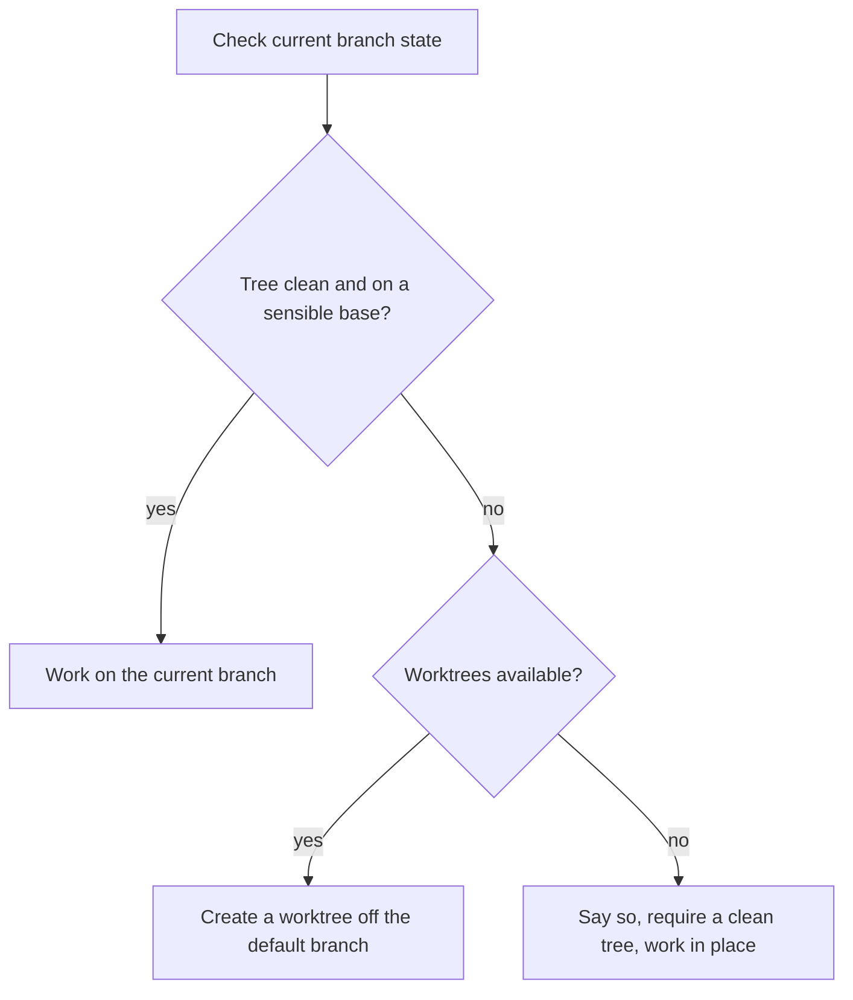

# Phase 0: intake

Five steps, in this order. The order is not cosmetic: doing them out of sequence is how a ledger ends up in a directory the run abandons, and stopping after step 4 is how a parent ends up doing the roster's work itself.

1. [Probe capabilities](#1-probe-capabilities)
2. [Decide the working tree](#2-decide-the-working-tree)
3. [Fix run identity](#3-fix-run-identity)
4. [Seed the ledger](#4-seed-the-ledger)
5. [Launch the first worker](#5-launch-the-first-worker)

## 1. Probe capabilities

The rest of the workflow assumes git, a remote host, worktrees, and a test suite. UI work also needs a way to render the real route. Check rather than assume, and record what you find. Every missing capability has a degraded path, listed at the bottom of this file.

```bash
git rev-parse --is-inside-work-tree 2>/dev/null          # git at all?
git remote get-url origin 2>/dev/null                    # a remote?
gh auth status 2>&1 | head -3                            # GitHub, authenticated?
git worktree list 2>/dev/null                             # worktrees usable?
gt --version 2>/dev/null                                  # Graphite CLI present?
test -f "$(git rev-parse --git-path .graphite_repo_config 2>/dev/null)"  # gt init done?
gt auth 2>&1 | head -1                                    # Graphite authed? "No auth token set" means no
```

Intake itself needs no worker. Determine these yourself:

- **The test command.** Look at the `scripts` block, the CI config, or a test runner config file. Do not guess from the language.
- **UI evidence in the task.** Record whether the request changes a rendered surface and whether it supplies a Figma URL, screenshot, attachment, or layout spec. Read [ui.md](ui.md) immediately when either fact is true.
- **The render check.** Note an available browser or computer-use tool, or an existing browser or end-to-end command in the repo. Record `none` when the route cannot be rendered yet. Recon refines the start command, route, state, and viewports. A trivial UI run that skips recon must do a minimal route, start-command, and representative-state lookup before verify.
- **Whether the supercook agents are installed.** Look for `supercook-*` in the host subagent catalog, meaning the subagent types this session lists for its launch tool. Agent files on disk (`agents/supercook-*.md`) supply prompt bodies but do not make typed agents launchable; only the catalog counts, and it is fixed when the session starts. Check all nine names: an older installed copy lists eight, with no `supercook-plan-optimizer`, and a missing role uses the spawn-tool path for that role only. Record `supercook-agents: installed|no` on the capability line, naming any missing role (`installed, missing plan-optimizer`).
- **Which spawn path this session has.** Read your own tool list for a tool that starts another agent: the top-level list, a deferred or dynamic tool catalog (a Cloud Agent can list `Task` only there), and the subagent types. The assessor launch is the probe. Record `spawn: typed` when typed agents are installed, `spawn <tool name>` for another listed nested-spawn tool, or `spawn none` when none is listed. Never record a tool you cannot see. If launches fail after the retry ladder in [../SKILL.md](../SKILL.md#start-here-the-launch-rule), rewrite the field to `spawn none (launches failed: <error>)`. The path for each value is in [../agents.md](../agents.md#spawn-paths-when-typed-agents-are-missing).
- **Which host shape this parent has.** Record `parent-host: cursor-chat|project-worker|cloud-agent|unknown` on the capability line when you can tell; otherwise `unknown` after a good-faith read of the session (Project worker brief, cloud task banner, editor chat, etc.). Use `parent-host` so the line stays distinct from `host github` (the forge).
- **Turn 1 on cloud and Project workers.** Read [../SKILL.md](../SKILL.md) in full before phase 0 file writes, before treating the assignment as the plan, and before any product edit. The assignment may restate objectives; it does not replace SKILL.md.
- **The model roster.** Resolve it once, here, by the rules in [../models.md](../models.md#how-a-role-becomes-a-model): merge `<workspace-root>/.supercook/models.md`, then `~/.supercook/models.md`, then the shipped file, per role. Write one ledger header, **`models:`**, a ` | `-separated line listing **every** roster key with its slug or plain `inherit`. Do not pre-validate slugs: a launch that rejects a model takes the retry ladder in [../SKILL.md](../SKILL.md#start-here-the-launch-rule), and the row records the model actually used. When the spawn tool has no model field, or `spawn: none`, roles run on the session model; write `inherit` for every role. The user can change any role's model at any point, per [../models.md](../models.md#changing-a-model-mid-run). Match the format in [ledger.md](ledger.md).
- **Stacking path.** Prefer Graphite when all three hold: `gt` is installed, the repo has been `gt init`-ed (`.graphite_repo_config` exists under the git dir), and Graphite is authenticated (`gt auth` does **not** print `No auth token set`). Otherwise use the manual stack lifecycle in [delivery.md](delivery.md#the-stack-lifecycle). Presence of `gt` alone is not enough: an unauthenticated CLI must record `stacking manual`.

Write one capability line to the ledger header:

```
capabilities: git yes | host github (gh authed) | worktrees yes | tests `pnpm vitest run` | PRs yes | stacking gt | supercook-agents installed | spawn typed | parent-host cursor-chat
ui-change: yes | ui-source: figma <canonical URL> | render-check: browser
```

`parent-host` uses the probe values `cursor-chat`, `project-worker`, `cloud-agent`, or `unknown`.

`ui-change` and `ui-source` are independent. A UI change often has no supplied
design, and a design attached to an investigation does not authorize a UI change.

Use `stacking gt` when Graphite is usable, or `stacking manual` when it is not. Delivery and merge read that field and do not re-run the full probe. **Exception:** if a later `gt` command fails specifically because auth is missing or expired, rewrite the ledger capability to `stacking manual`, log the change, and continue on the manual path. Do not stay stuck on a sticky wrong mode.

**Cold merge exception.** On the merge track, `stacking gt` is only usable when the target PR's branch is already tracked by Graphite (it appears in `gt log` / `gt log short`). PRs opened with plain `git`/`gh` and never `gt track`-ed stay on the manual path for this run, even if the repo is otherwise Graphite-ready. Optionally `gt track --force` the chain first if the parent bases are clear; if tracking would guess wrong, keep `stacking manual` for the walk.

## 2. Decide the working tree

Do this before creating any file, so the ledger is born inside the tree the run will actually use.



Unrelated uncommitted or unpushed work is the case worktrees exist for. Do not stash someone's work and do not commit it into your run.

**The merge track skips this decision.** The PR's branch already exists, so there is nothing to create: check it out with `gh pr checkout <n>` and work there. No worktree and no new branch. See [../playbooks/merge.md](../playbooks/merge.md).

**The review track checks out per PR.** Start on the bottom PR's branch after stack resolution ([Review track, cold start](#4-seed-the-ledger) above). No new run branch; slice branches already exist.

**Merge track plus Graphite.** Still check out the PR branch in place. Before `gt sync` / `gt submit` / `gt merge`, run `git worktree list` and confirm no other worktree has a stack sibling checked out. Graphite skips those branches, so a sibling parked in another worktree would be left stale. Free that checkout, or fall back to the manual restack for the affected children.

```bash
git worktree add ../<repo>-<slug> -b supercook/<slug> origin/<default-branch>
```

Creating a worktree is a reversible write, so it may need host approval. Ask once with the reason, log the answer, and continue. Never assume it.

**When stacking with Graphite**, run `gt sync`, `gt restack`, and `gt submit` from this run's working tree (the worktree when one exists, otherwise the checkout in use). From gt 1.8.4 onward those commands skip non-trunk branches that are checked out in another worktree, so stack maintenance done from the wrong tree silently leaves children stale.

## 3. Fix run identity

Resume depends entirely on this, so write it down before anything else happens.

- **run-id**: `<YYYY-MM-DD>-<slug>-<4 random chars>`. The random suffix is what keeps two runs on the same task apart.
- **repo**: the remote URL when one exists, else the output of `git rev-parse --show-toplevel`.
- **branch** and **worktree path**.
- **done**: the checkable predicate that ends this run. Write it as something you could test, not as an aspiration.

## 4. Seed the ledger

**Skip this step entirely on the investigation track**, and on any request that is explicitly read-only. Those runs keep the record in the todo list instead, which satisfies the same purpose without writing to someone's repo during a read-only ask. See [../playbooks/investigation.md](../playbooks/investigation.md). Steps 1 through 3 still run, minus the worktree.

Otherwise: create `.supercook/<run-id>/` in the chosen tree, then write `ledger.md` with the header, every phase as an unchecked row, and the routed playbook's steps copied in verbatim. Format and lifecycle rules live in [ledger.md](ledger.md).

Name the worker on every roster row as you seed it, for example `- [ ] implement: supercook-implementer, one launch per slice`. A resumed or compacted session re-reads the ledger, not this skill, so the row is where the next turn learns that the phase is a launch and not its own to-do.

**The merge track does not get the investigation exception.** It changes the repo and it can span sessions while checks run, so it needs the record more than most runs, not less. Seed the ledger, with the target PR number in the header.

**Review track, cold start.** Route **review**, never **merge**, when the primary ask is `review` or `review and merge` (see [../SKILL.md](../SKILL.md#user-selected-track-routing)). Before any reviewer launch:

1. **Resolve the full stack.** PR numbers named in the ask, or the current branch's open PR plus every open PR stacked on it (`gh pr view` / `gh pr list`, each PR's `baseRefName` to build the dependency chain).
2. **Order bottom-up** (trunk-facing PR first, tip last).
3. **Record in the ledger header** the ordered PR list, each PR's base branch, and `mode: review` or `mode: review+merge`.
4. **Seed one nested ledger block per PR** with the review playbook rows (fan-out, triage, implementer, verify, confirmation pass, CI) before checking out the first branch.

Assessor (phase 1) does not run on this track.

**On `implement-plan`, pin the supplied plan next.** Once the run folder exists, copy the resolved plan source verbatim to `user-plan.md` in that folder and echo the plan title. Later phases read that file, not chat scrollback. See [../playbooks/implement-plan.md](../playbooks/implement-plan.md).

Keep the run folder out of git without touching `.gitignore`:

```bash
EXCLUDE=$(git rev-parse --git-path info/exclude)
grep -qxF '.supercook/' "$EXCLUDE" 2>/dev/null || printf '\n.supercook/\n' >> "$EXCLUDE"
```

Use `git rev-parse --git-path`, never a literal `.git/info/exclude`: a linked worktree has a `.git` **file**, not a directory, so the literal path would create a stray file that excludes nothing. The write is idempotent, and it lands in the **shared** exclude file, so the entry covers every worktree of the repo and outlives this run.

Skip the write entirely when the probe says this is not a git repo.

Finally, mirror the phase rows into the todo list so progress is visible live.

When a track seeds a ledger, write `.supercook/active-run` with that ledger's relative path. Delete that file when deliver is checked or the run is abandoned. The investigation track does not write it.

## 5. Launch the first worker

Intake ends on a launch, not on an edit. With the ledger seeded (or the todo list, on the investigation track), the next action is one of these:

- **Assessor-routed run:** launch `supercook-assessor` through the `spawn:` path on the capability line, passing the raw task text, the repo name, and the capability line. The launch contract is in [../agents.md](../agents.md#supercook-assessor).
- **`implement-plan`:** launch `supercook-explorer` against the areas `user-plan.md` names.
- **`review`:** start the reviewer fan-out in [../playbooks/review.md](../playbooks/review.md).
- **`merge`:** no roster phase up front. The merge loop in [merge.md](merge.md) is the coordinator's own work.

With `spawn none`, run that same role inline under [solo mode](../agents.md#no-spawn-tool-run-roles-inline), logged as `inline`. Before the first inline role, record `spawn none` on the capability line.

Until that first worker has returned, do not open the task's source to start on the work and do not settle on a tier. A task that already looks small enough for one pass is exactly the call the assessor exists to make, and every roster phase after it is its own launch too, per [../SKILL.md](../SKILL.md#start-here-the-launch-rule).

## Degraded paths

Announce the degradation in one line, log it, and continue. Never fail the run over a missing capability.

| Missing | What changes |
|---|---|
| git | No worktree, no branch, no PR. Work in place, keep the run folder in the system temp dir, deliver a summary plus the diff. |
| GitHub, or `gh` not authenticated | Phases 0 through 7 run unchanged. Delivery stops at a pushed branch or a local commit series, with the PR body written into the run folder to paste wherever it is needed. |
| Worktree support | Say so, require a clean tree, work on the current branch. |
| Graphite CLI, `gt` not authenticated, repo not `gt init`-ed, or non-GitHub host | Record `stacking manual`. Delivery and merge use the manual stack lifecycle in [delivery.md](delivery.md#the-stack-lifecycle) and [merge.md](merge.md#stacked-prs). Everything else is unchanged. |
| A runnable test suite | Test-first becomes verification-first. The test designer returns an executable recipe; the parent writes it in the run folder and records its path in `plan.md`, or the ledger on open-pr, and the verifier runs it. The journey thinking survives; only the assertion mechanism changes. |
| A readable supplied UI source | Ask once for a screenshot, a written layout spec, or authorization to proceed without it. Record the answer before planning. Never invent the source's contents. |
| A renderer for a changed route | Write a fully specified manual smoke row with the route, state, viewports, and checks. It is sanctioned-blocked until the user confirms it or accepts delivery with the missing visual evidence named. |
| Write access | Investigation track only, since nothing can ship. Same no-file behavior as that track. |
| The supercook agents | With any listed spawn tool, launch each role as a worker named `supercook-<role>` with its `agents/supercook-<role>.md` body; the parent does not solo-implement. With `spawn: none`, each role runs inline in the parent from its agent file, under the same contract and guards. See [../agents.md](../agents.md#spawn-paths-when-typed-agents-are-missing). |
| An available model slug | The launch is rejected, the retry ladder drops the `model` field, the role runs on the session model, and the launch row says `inherit`. Tell the user once. |
| Repository or home model override | Missing `<workspace-root>/.supercook/models.md` or `~/.supercook/models.md` is the default: fall through silently to the next tier ending at the shipped roster in [../models.md](../models.md). A repository override wins per role over home and shipped; say nothing about it. |
| A PR template, or one that is mandatory | The three PR body sections become the minimum content and get fitted into the template's fields rather than replacing them. Check for `.github/pull_request_template.md` during the probe. |
